<p align="center">
  <a href="https://griffdog21.github.io/stremio-marquee/"></a>
</p>

<h3 align="center">Eight cinematic themes for Stremio, on every screen. Google TV included.</h3>

<p align="center">
  Original poster art · widescreen spotlight rows · curated collections · your own images · matching desktop themes
</p>

<p align="center">
  <a href="https://griffdog21.github.io/stremio-marquee/"></a>
  <a href="https://griffdog21.github.io/stremio-marquee/studio.html"></a>
  <a href="https://griffdog21.github.io/stremio-marquee/lineup.html"></a>
</p>
<p align="center">
  <a href="https://github.com/Griffdog21/stremio-marquee/actions/workflows/pages.yml"></a>
  
  
  
  
</p>

---

<p align="center">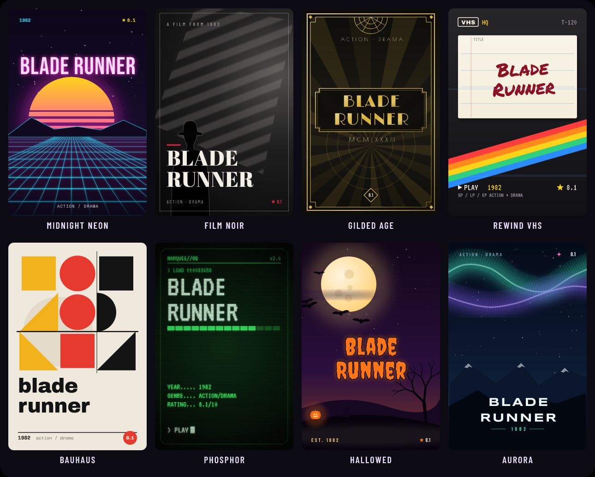</p>
<p align="center"><sub>One title, eight styles. Every poster is generated from scratch (no studio artwork) using the title, year, genres and rating.</sub></p>

## ✨ What Marquee does

Stremio add-ons can't repaint the app itself, but they **can** fill your home screen with rows, posters, images and text. Marquee turns that into a theme engine:

- 🎨 **Generated poster art** in eight distinct styles, rendered as plain JPEGs so every Stremio app shows them, from Google TV and Android TV to iOS, desktop and web.
- 🖼️ **Widescreen spotlight rows**: a cinematic, Netflix-style hero row of 16:9 cards built from each theme's hand-picked collection.
- 🎞️ **Curated collections** per theme (*Neon Nights*, *Shadows & Smoke*, *Midnight Monsters*…) plus a genre **mood row**.
- 🧑‍🎨 **The Studio**: mix any palette with any art style, rename and reshape rows, swap in your **own poster images**, set your own add-on logo and backdrop, build rows from your favourite titles, and watch it all live on a virtual TV.
- 🖥️ **Full UI themes** for the apps that accept CSS: [Stremio Enhanced](https://github.com/REVENGE977/stremio-enhanced) on desktop and [Stylus](https://add0n.com/stylus.html) on web.stremio.com, each with a signature effect (noir turns posters black & white until you hover).
- 📺 **Lineup**: reorder your home screen so the theme leads, even on your TV.
- 💸 **Free forever**: the stock themes are static files on GitHub Pages, rebuilt daily by GitHub Actions. Nothing to host.

## 🎬 Now showing

<table>
  <tr>
    <td width="50%"><a href="https://griffdog21.github.io/stremio-marquee/?theme=neon#install">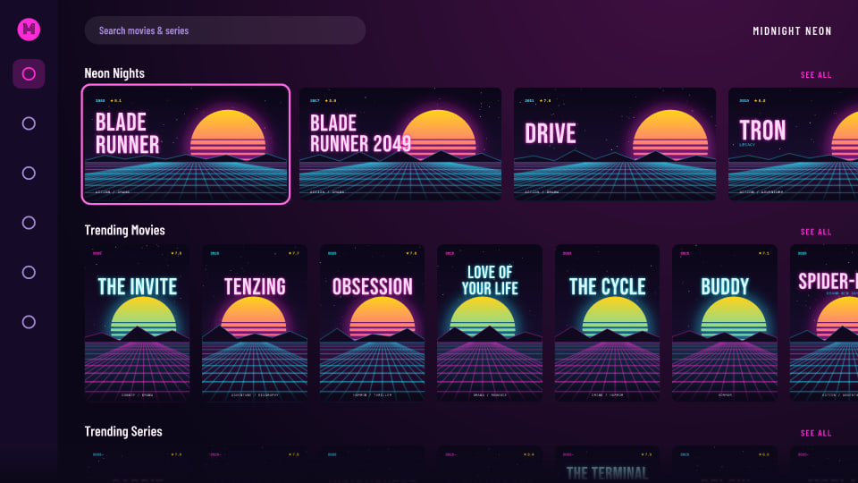</a><br><b>🌆 Midnight Neon</b><br><sub>Synthwave suns, laser grids and hot-pink glow.</sub></td>
    <td width="50%"><a href="https://griffdog21.github.io/stremio-marquee/?theme=noir#install">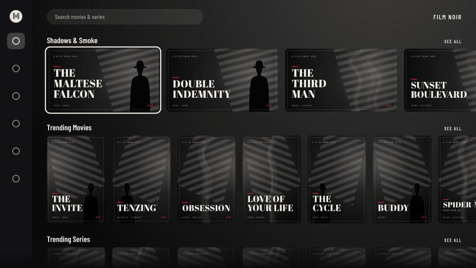</a><br><b>🎞️ Film Noir</b><br><sub>Venetian-blind shadows, cigarette smoke and one red accent.</sub></td>
  </tr>
  <tr>
    <td><a href="https://griffdog21.github.io/stremio-marquee/?theme=deco#install">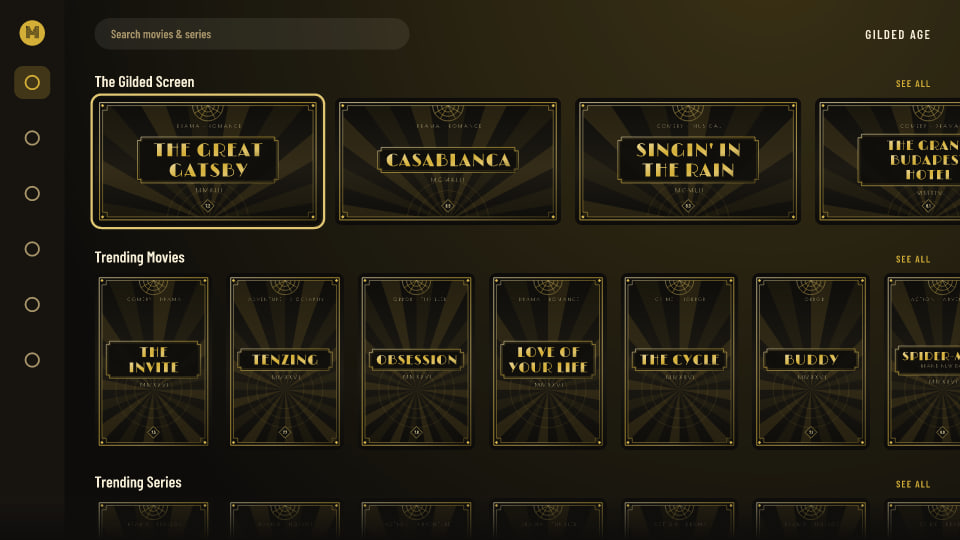</a><br><b>✨ Gilded Age</b><br><sub>Art-deco sunbursts, stepped frames and liquid gold.</sub></td>
    <td><a href="https://griffdog21.github.io/stremio-marquee/?theme=vhs#install">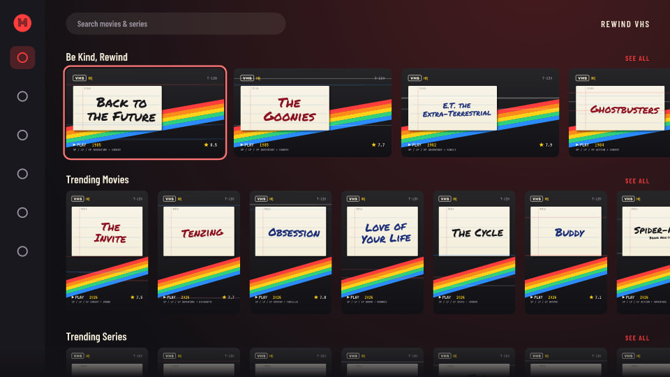</a><br><b>📼 Rewind VHS</b><br><sub>Rainbow-stripe tape labels, tracking glitches, Sharpie titles.</sub></td>
  </tr>
  <tr>
    <td><a href="https://griffdog21.github.io/stremio-marquee/?theme=bauhaus#install">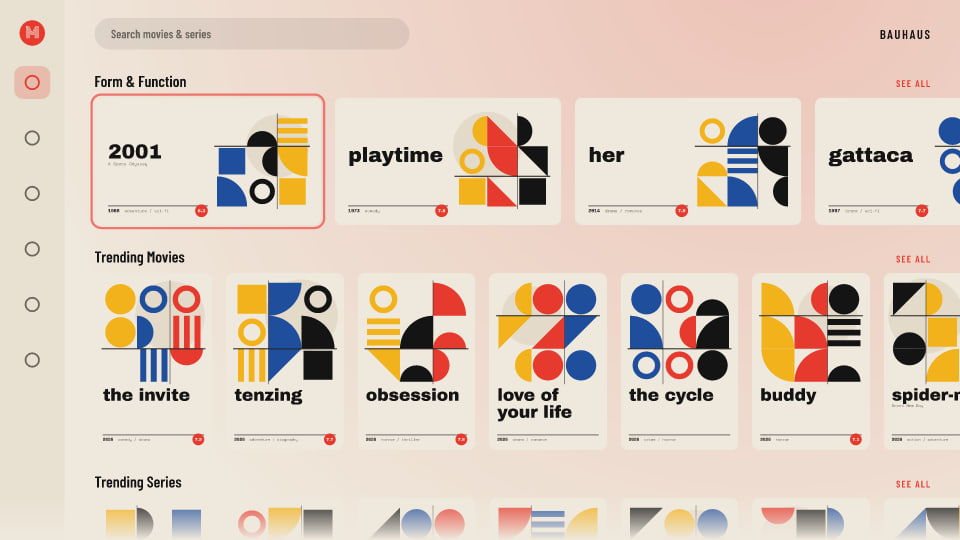</a><br><b>🔴 Bauhaus</b><br><sub>Primary colours, pure geometry, lowercase type.</sub></td>
    <td><a href="https://griffdog21.github.io/stremio-marquee/?theme=terminal#install">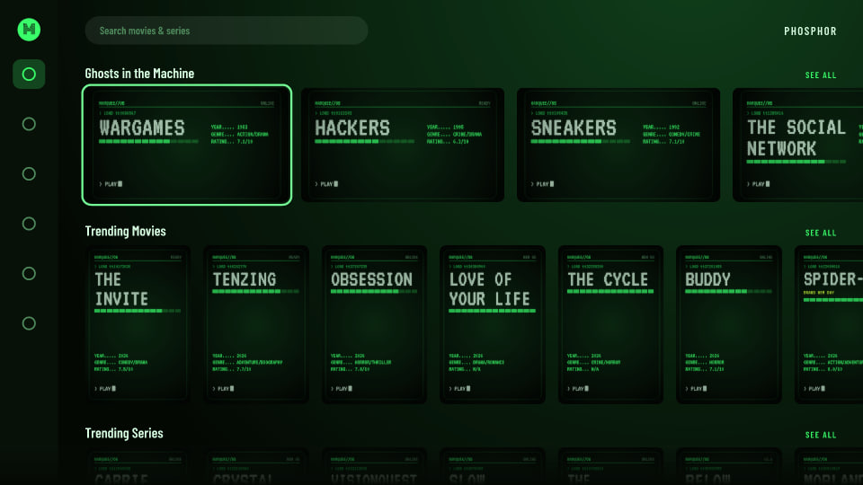</a><br><b>💾 Phosphor</b><br><sub>Green-screen CRT, scanlines and a blinking cursor.</sub></td>
  </tr>
  <tr>
    <td><a href="https://griffdog21.github.io/stremio-marquee/?theme=haunt#install">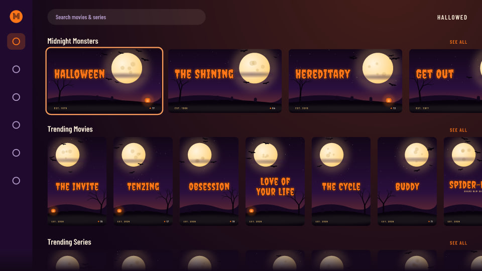</a><br><b>🎃 Hallowed</b><br><sub>Harvest moons, bats and graveyard hills. Halloween all year.</sub></td>
    <td><a href="https://griffdog21.github.io/stremio-marquee/?theme=aurora#install">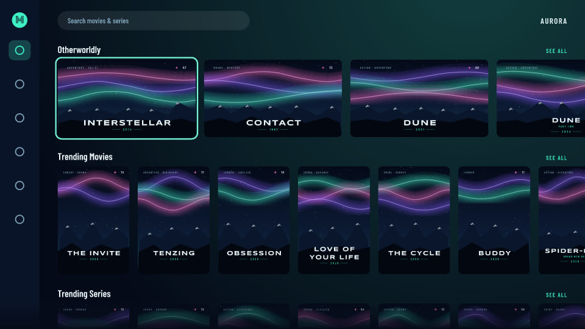</a><br><b>🌌 Aurora</b><br><sub>Northern lights rippling over midnight peaks.</sub></td>
  </tr>
</table>

## 📺 Install on Google TV (or anything else)

Add-ons live in your **Stremio account**, so you install once, on any device, and they sync everywhere you're signed in.

1. On your **phone or computer**, open **[griffdog21.github.io/stremio-marquee](https://griffdog21.github.io/stremio-marquee/)**, pick a theme and tap **Install in Stremio** (or **Install via Stremio Web** if you don't have the app on that device). You can also scan the QR code from the site with your phone.
2. Open Stremio on your **Google TV**, signed in to the same account. Marquee's rows appear on the home screen; restart the app if it was already open.
3. *(Optional)* Open **[Lineup](https://griffdog21.github.io/stremio-marquee/lineup.html)** to move Marquee's rows to the top and hide the ones you don't want.

<details>
<summary><b>Manifest URLs</b> (paste into Stremio → Add-ons → search box)</summary>

| Theme | Manifest |
| --- | --- |
| 🌆 Midnight Neon | `https://griffdog21.github.io/stremio-marquee/addon/neon/manifest.json` |
| 🎞️ Film Noir | `https://griffdog21.github.io/stremio-marquee/addon/noir/manifest.json` |
| ✨ Gilded Age | `https://griffdog21.github.io/stremio-marquee/addon/deco/manifest.json` |
| 📼 Rewind VHS | `https://griffdog21.github.io/stremio-marquee/addon/vhs/manifest.json` |
| 🔴 Bauhaus | `https://griffdog21.github.io/stremio-marquee/addon/bauhaus/manifest.json` |
| 💾 Phosphor | `https://griffdog21.github.io/stremio-marquee/addon/terminal/manifest.json` |
| 🎃 Hallowed | `https://griffdog21.github.io/stremio-marquee/addon/haunt/manifest.json` |
| 🌌 Aurora | `https://griffdog21.github.io/stremio-marquee/addon/aurora/manifest.json` |

</details>

## 🧭 What changes where

|  | Google TV / Android TV | Phone & tablet | Desktop | Stremio Web |
| --- | :---: | :---: | :---: | :---: |
| Themed poster art on home rows | ✅ | ✅ | ✅ | ✅ |
| Widescreen spotlight rows | ✅ | ✅ | ✅ | ✅ |
| Curated collections + mood rows | ✅ | ✅ | ✅ | ✅ |
| Your own posters, logo & backdrop (Studio) | ✅ | ✅ | ✅ | ✅ |
| Row order / hidden rows (Lineup) | ✅ | ✅ | ✅ | ✅ |
| App colours, fonts, focus glow | — | — | ✅ via Stremio Enhanced | ✅ via Stylus |

> **Why no app colours on TV?** Stremio add-ons speak a data protocol (catalogs, metadata, streams, subtitles); there's no way for an add-on to inject styles into the app. Marquee themes everything an add-on *can* reach, and ships real CSS themes where Stremio accepts them.

## 🧑‍🎨 The Studio

**[Open the Studio →](https://griffdog21.github.io/stremio-marquee/studio.html)**

- **Theme & art style**: start from any theme, then mix in another theme's art (Bauhaus geometry in neon colours, a VHS sleeve in noir greys…) or switch to original posters.
- **Colours**: seven-colour palette with live preview.
- **Rows**: show/hide, rename, reorder, and pick a card shape per row: poster, widescreen or square.
- **Your images**: replace any title's poster with your own image URL; set the add-on's logo and backdrop.
- **Your collections**: search Cinemeta or paste IMDb links to build up to six rows of your own.
- **Export**: download the same palette as a Stremio Enhanced or Stylus theme, or share a link to your design.

The eight stock themes are static and free. Fully custom setups are rendered live, so they need a Marquee server ([one click, below](#self-hosting)).

## 🖥️ Desktop & web themes

Each theme also ships as a full UI theme that restyles Stremio's own colours, background, focus glow and row titles, plus a signature effect.

| | Stremio Enhanced (desktop) | Stremio Web (Stylus) |
| --- | --- | --- |
| Get it | Download `*.theme.css` from the [site](https://griffdog21.github.io/stremio-marquee/#desktop) | Open the `*.user.css` link from the [site](https://griffdog21.github.io/stremio-marquee/#desktop) |
| Install | Settings → **Open themes folder** → drop it in → restart → apply | Stylus offers to install it |
| Updates | Automatic (`@updateUrl`) | Automatic (`@updateURL`) |

## 📋 Lineup (beta)

Stremio orders home rows by add-on. **[Lineup](https://griffdog21.github.io/stremio-marquee/lineup.html)** reorders your add-ons and hides individual rows, straight from your browser:

- Talks only to Stremio's own API (`api.strem.io`); nothing is stored or sent anywhere else.
- Downloads a backup before every save, and can restore it.
- Never uninstalls anything. Warns before you hide Cinemeta's *Popular* rows (they power search).

## 🚀 Self-hosting

Needed only for **custom Studio setups**. One click:

[](https://vercel.com/new/clone?repository-url=https%3A%2F%2Fgithub.com%2FGriffdog21%2Fstremio-marquee&project-name=marquee)
[](https://render.com/deploy?repo=https://github.com/Griffdog21/stremio-marquee)

Then paste your server's address into the Studio's **Install** panel. Or run it anywhere with Docker or Node:

```bash
docker build -t marquee . && docker run -p 7000:7000 marquee
```

```bash
npm ci && npm run build:site && npm start
```

Stremio only installs remote add-ons over **HTTPS** (plain `http://127.0.0.1` works for local testing).

## ⚙️ How it works

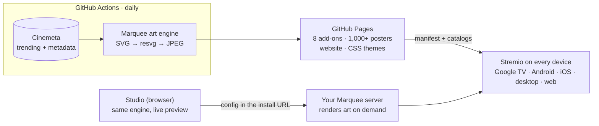

- **One engine everywhere.** `src/core` is plain ES modules: themes, the eight art templates, text fitting, manifests and catalogs. The same code runs in the GitHub Actions build, the Node server, and your browser (the Studio's live preview).
- **Text fits, always.** Glyph advance widths for every bundled font are precomputed (`src/core/font-metrics.js`), so titles are wrapped, balanced and sized identically in Node and the browser.
- **Stateless server.** A custom setup lives entirely in its install URL (`/<config>/manifest.json`), and every poster's data travels in its own image URL, so the server can scale to zero.
- **Real IMDb IDs.** Catalog items keep their `tt…` IDs, so your stream add-ons, library and watch history work exactly as before.

## 🛠️ Development

```bash
npm ci
npm test                      # 21 tests: linting manifests, rendering every template, server routes
npm run contact-sheet         # render every template against tricky titles → .cache/contact/
npm run build                 # full static build → dist/ (MARQUEE_THEMES=haunt for one theme)
npm run serve                 # preview dist/ like GitHub Pages
npm start                     # live addon server on :7000
```

| Path | What lives there |
| --- | --- |
| `src/core/` | Themes, art templates (`art/*.js`), text layout, config, manifest & catalog builders, CSS theme generator |
| `src/node/` | Cinemeta client, SVG → PNG/JPEG rendering |
| `src/server/` | The live addon (Node `http`, Vercel and Docker entry points) |
| `site/` | The website: landing page, Studio, Lineup |
| `scripts/` | Static build, font metrics, collection resolver, README artwork |
| `data/` | Curated collections (titles → verified IMDb IDs) |

**Add a theme:** add a palette to `src/core/themes.js`, a template to `src/core/art/`, a collection to `data/collections.source.json` (`npm run collections`), and check it with `npm run contact-sheet`. PRs welcome!

## 🙏 Credits

- Title data from **Cinemeta**, the open catalog behind Stremio's own home screen.
- Fonts: Monoton, Bebas Neue, Abril Fatface, Limelight, Poiret One, VT323, Archivo Black, Creepster, Space Mono, Barlow Condensed (SIL OFL 1.1), Permanent Marker and Syncopate (Apache 2.0). Licenses in [`fonts/licenses`](fonts/licenses).
- Rendering by [resvg](https://github.com/RazrFalcon/resvg) and [sharp](https://sharp.pixelplumbing.com/).

Marquee is a fan-made, open-source project. It is **not affiliated with or endorsed by Stremio**. It provides catalogs only and does not host or link to any streams. Released under the [MIT License](LICENSE).
